# Web Review 01 : Web Request Autopsy 🔎

## Disclaimer : 
Most of these "issues" are resolved with a fast connection. I am purposely throttling my connection to 4G and disabling caching to find these.

I am not an expert web developer so take all of this with a grain of salt. It's more just to go through the dev tools.

## Task :

- Select 3 sites and 1 page "request autopsy" using browser developer tools, the timeline of the main document request, number of requests,total bytes, render blocking resources, and possible optimizations (probably picked using lighthouse), written as "phase" or "bottleneck"
- Include screenshots as evidence:
    - path > /{host}/{file}

## Purpose : 

- Review developer tool in browsers

--------------------
--------------------

### Site 1 : https://uga.edu/

 | Category     | Findings  |
 | ------------ | --------- |
 | Site and conditions | 10/25/26, Chrome, 4G throttling, Network developer tool with Disable cache ticked (cold HTTP cache). DNS was cached and the connection reused, so no DNS or connection phases appeared. | 
 |Main document timeline |     • Queueing .67ms • Stalled .65ms • Request .62 ms • Waiting for server response (TTFB) 166.32 ms • Content Download 3.94ms |
| Totals | 144 requests - 18.8 MB transferred - 11.4 MB resources loaded - Load 7.65s -  LCP (in performance tab) 4.16s |
| Render-blocking (lighthouse) |  • /css/app.2150044f.css - 221.1 KiB - 400 ms • /js/app.535a9183.js - 98.4 KiB • /css/chunk-vendors.71d1adc2.css - 27.1 KiB • …js/dataprivacy-cookie.js(cdn.uga.edu) - 2.9 KiB - 370 ms • 2 CDNs -> • …font/bootstrap-icons.css(cdn.jsdelivr.net) 10.1 KiB - 370 ms • /css?family=…(fonts.googleapis.com) - 1.3 KiB - 370 ms | 
| Optimization |  One Bottleneck is the external stylesheets /css/app.2150044f.css and /css/chunk-vendors.71d1adc2.css. Either making these optional for the first load or identifying which can be loaded in line inside the existing `<style>` tag would save approximately 360 ms, 197.1 KiB and 120 ms, 25.8 KiB respectively. These savings are identified by lighthouse in the "reduce unused CSS" section which identifies CSS stylesheets that block rendering, and the rules in them that are not used at all. Their timings are in the render blocking requests section. By optimizing these you improve render timings and get rid of rules that are not used at all.  |

#### Evidence:
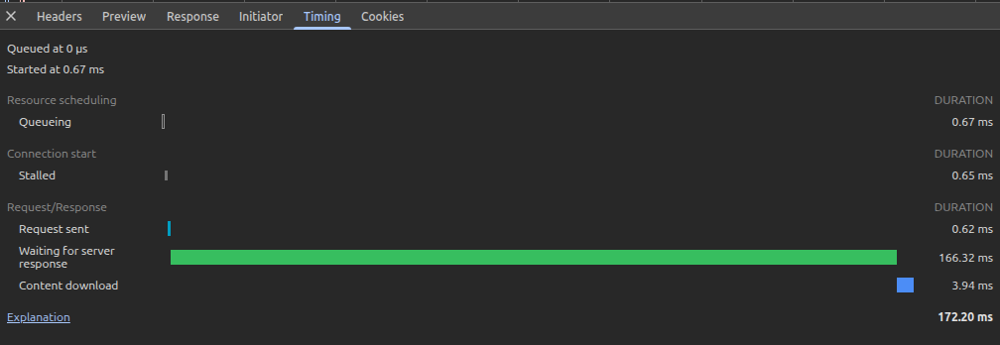

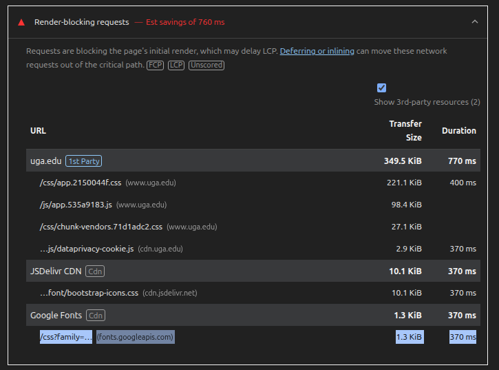

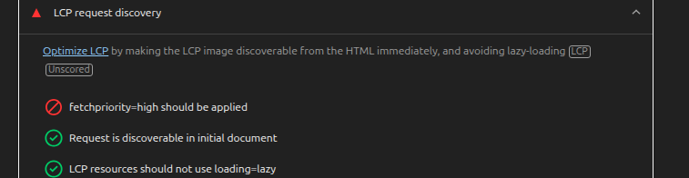

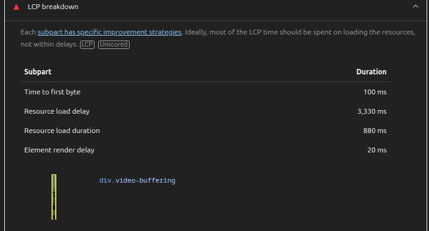

---
---

### Site 2 : https://georgia.gov/
 | Category     | Findings  |
 | ------------ | --------- |
  | Site and conditions | 10/25/26, Chrome, 4G throttling, Network developer tool with Disable cache ticked (cold HTTP cache). DNS was cached, so no DNS phase appeared; a new connection was made. | 
 |Main document timeline |         • Queueing .51 ms • Initial Connection 52.40ms    • Request .12ms    • Waiting for Server/ TTFB 67.56ms    • Content Download .95ms|
| Totals | 28 Requests, 2.6 MB transferred, 4.6MB resources loaded, Total Load Time : 2.9s , LCP 2.96s |
| Render-blocking (lighthouse) |  External Style sheets seem to be the big render blocking resources.(From Render blocking requests in Lighthouse)  …css/css_YmzRX….css?delta=…(georgia.gov) 67.7 KiB 110 ms - …css/css_jvr4C….css?delta=…(georgia.gov) 4.9 KiB. As well as the time it takes to load the splash image (from LCP breakdown for div.hero-teaser__image) - Resource load delay 940 ms - Resource load duration 2,070 ms| 
| Optimization | Lighthouse identified several optimizations for how images are delivered in this web page. One improvement will come from optimizing the hero image since that is the div.hero-teaser__image (…2023-05/138….jpg?itok=S7WQAV2Q) this resource is 638kiB as identified in the "improve image delivery" section. If we look in the LCP breakdown section Lighthouse identifies that this image is the cause for the largest contentful paint and takes approximately 2,070 ms to load in "Resource load duration". The estimated size savings in lighthouse for converting this image is 12.3 KiB which is approximately a 2% optimization in file download size. This would scale to the timing so a 2% improvement of 2070ms is an improvement of 41.4ms reducing the images load time to 2028.6ms. A local override for preloading was tested by using the dev tools local override feature to write a preload link in the `<head>` of the page    `<link rel="preload" as="image" fetchpriority="high" href="/sites/georgia.gov/files/styles/landing_page_hero_2400px/public/2023-05/1386575135-GAGovBlueSky-3000-2.jpg?itok=S7WQAV2Q">` -- This however, did not improve the largest contentful paint or the resource load duration in any measurable impact.|

#### Evidence :

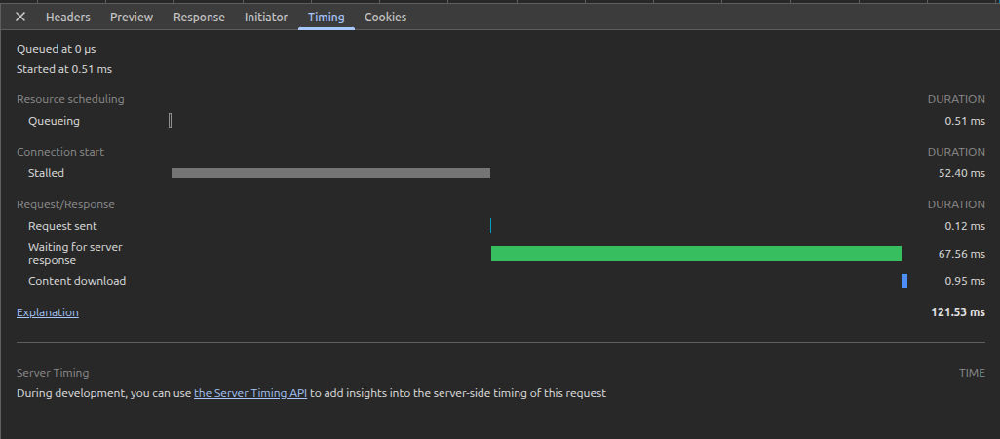

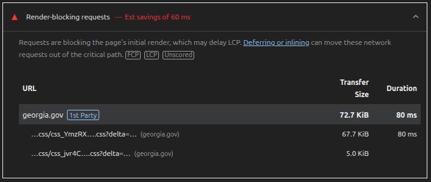

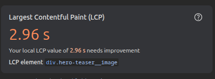

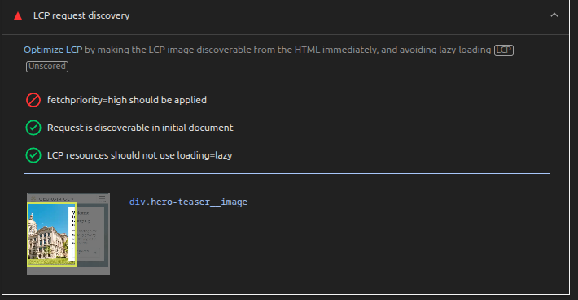

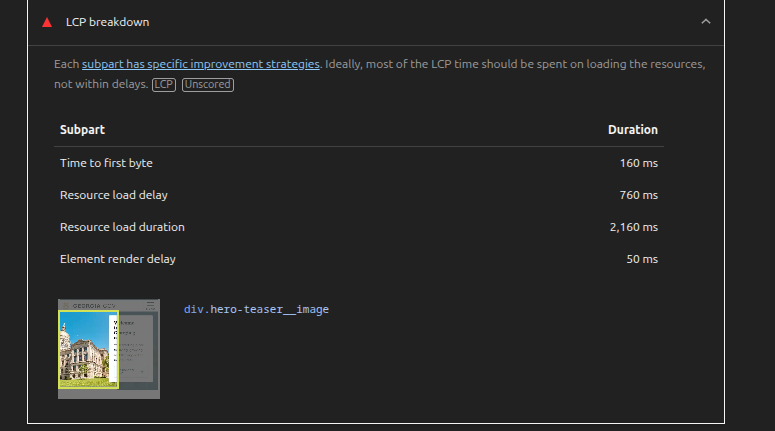

---
---
### Site 3: https://www.linkedin.com/ (The front login page)
 | Category     | Findings  |
 | ------------ | --------- |
  | Site and conditions |10/25/26, Chrome, 4G throttling, Network developer tool with Disable cache ticked (cold HTTP cache). DNS was cached and the connection reused, so no DNS or connection phases appeared.| 
 |Main document timeline | • Queueing 1.57ms     • Stalled .30ms    • Request .17ms • Waiting for Server/ TTFB 169.6ms    • Content Download 14.62ms|
| Totals | Starts with 47 requests (but increases with LinkedIn’s tracking events) , 2.0 mb transferred , 5.3 mb in resources , load time is 706ms, and LCP is 0.60 s |
| Render-blocking (lighthouse) |  An External Css sheet for its ads that are running on the page …h/8bnxn2t783wxez9h12gkxfnlx(static.licdn.com) 41.0 KiB	420 ms . Based on the name : "LinkedIn Ads" If these were removed there is an estimated savings from lighthouse of 420 ms|
| Optimization | There’s a not a lot to optimize here. It scores 99 on the lighthouse score overall. The only thing that is render blocking is the ad elements and they’re not going to take those out or change them I imagine. Lighthouse identifies that these ad's are using legacy javascript …h/29rdkxlvag0d3cpj96fiilbju(static.licdn.com) estimate savings : 54.0 KiB -- …h/fx69lqty609xpf6l4xb6bs3a(static.licdn.com) Estimated savings : 45.4 KiB. -- The total size of these two scripts is 139.2 KiB and the estimated savings from updating or removing the legacy elements is 99.3 KiB in size which is around 71% of saved size in downloaded content. However, due to the small original size and that its involved in ad scripts. This is unlikely to change. Based on the evidence the only optimization could be around the ad elements and how they are loaded. They could be loaded using `media=print` so that they are loaded without blocking the render. However, this would be unlikely since this could affect how ad styles are loaded and would probably run up against business standards. |

#### Evidence:

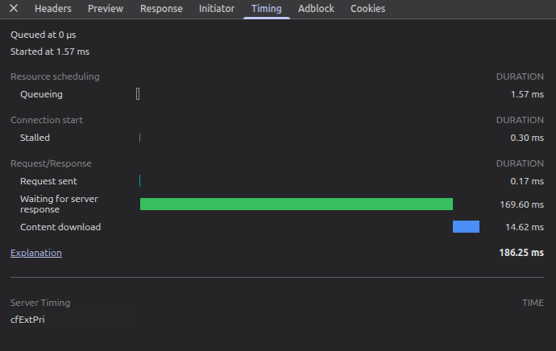

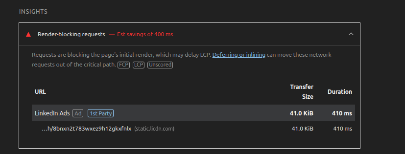

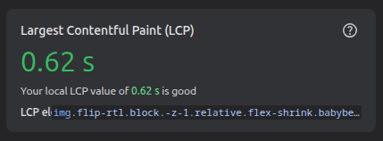

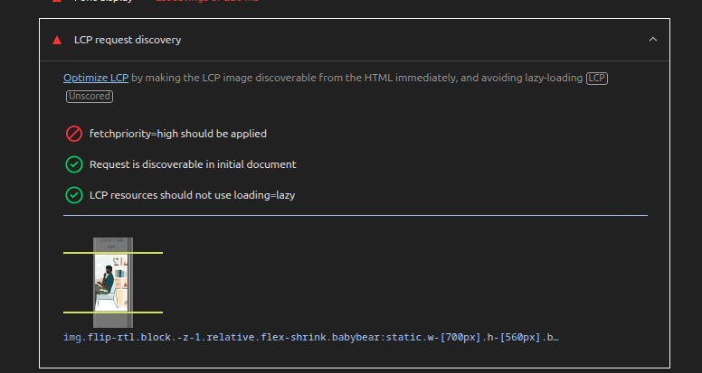

## Conclusion:
Using the web tools gave a good refresh of the timings and elements involved in the initial load and repaints of a website as it renders to the browser. Unsurprisingly, the UGA website had the most room for improvement, likely because it has less dedicated resources, or because it has a video playing on the front page as its "hero image". LinkedIn's website came in at the most optimized website of the three scoring a 99 on the lighthouse diagnosis. This is a corporate website that likely has multiple teams that are dedicated to maintaining, optimizing, analyzing, and improving it as it runs and new features are pushed to it. I also happened to notice that LinkedIn runs a tracking script that sends batches of events, this may be worth studying more in a separate session